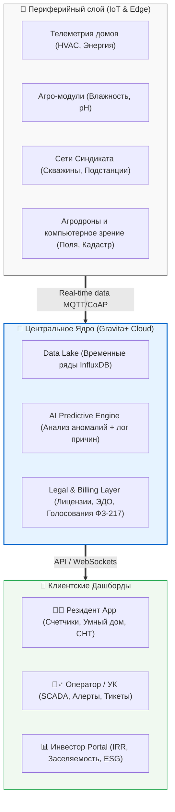

# 📊 Раздел 7. Управление на основе данных: ключевые показатели, ситуационный центр и метрики продуктивности

## 🧭 Навигация

- Вход: [README.md](README.md) · [Манифест-Питчбук](ТЭО_Родовое_Поместье_Введение_1_Манифест_Питчбук.md)
- Проверка: [Приложение 4: Источники и Бенчмарки](ТЭО_Родовое_Поместье_Приложение_4_Источники_и_Бенчмарки.md)
- Переход: [← Раздел 6. Финансовый инжиниринг](ТЭО_Родовое_Поместье_Раздел_6_Дом_в_ипотеку.md) · [Раздел 8. Правовые схемы реализации →](ТЭО_Родовое_Поместье_Раздел_8_Правовые_схемы_реализации.md)

---

> **Инвестиционный тезис:** Классический девелопмент завершает измерение эффективности на продаже квадратных метров. Родовое Поместье 3.0 рассматривает ввод домов в эксплуатацию как первый день запуска распределённого вычислительного и сервисного контура. Эффективность кластера оценивается по доступности узлов, пожизненной ценности резидента, энергоэффективности сети и объёму созданной интеллектуальной собственности. Управление идёт через единый ситуационный центр Gravita+.

---

## 🧠 7.1. Концепция: Кластер как высоконагруженная система интернета вещей

Сначала измеряется услуга, которая уже есть: связь, тепло рабочего места, заявка и время её закрытия. Объём данных сам по себе зрелостью не считается и в выручку не записывается. Снижение расхода энергии процентом заранее не обещается.

Ситуационный центр агрегирует данные из трёх слоёв:
1. **Машинный слой:** телеметрия интеллектуальной энергосети, датчики микроклимата, статус серверных стоек, потребление воды и тепла, беспилотный мониторинг агро-модулей.
2. **Операционный слой:** ERP синдиката, биллинг подписок, загрузка общих пространств и графики лизинговых платежей.
3. **Слой услуги:** заявки, бронирование и счета. Личный рейтинг семьи не ведётся.

---

## 📋 7.2. Матрица целевых показателей

В отличие от стандартного ИЖС, KPI Родовое Поместье 3.0 разделены на инфраструктурные (ответственность Синдиката) и резидентские (социально-экономические метрики узлов).

### Блок А: Инженерно-инфраструктурные показатели
Измеряет устойчивость инфраструктуры и качество сервиса синдиката.

| Метрика | Целевой бенчмарк | Инструмент контроля | Влияние на экономику |
| :--- | :--- | :--- | :--- |
| **Доступность базового ядра** | Ориентир до журнала эксплуатации, договором не является | Системы мониторинга, когда узел запущен | Непрерывность сервиса меряется по факту периода |
| **Доля автономной генерации** | Считается по счётчику за сезон. Порог «больше 60%» до работающего контура не назначается | Умные счётчики, когда они есть | Не обещание снижения расходов |
| **PUE (Power Usage Effectiveness)** | Считается после работающего контура, порогом заранее не назначается | Телеметрия охлаждения | Экономия появляется в отчёте, не в бенчмарке |
| **Срок реакции на аварию** | Считается по журналу диспетчерской. Порог «меньше 15 минут» до журнала не назначается | Дежурный человек | Не договорный SLA |
| **Zero Trace Index** | Гипотеза без замера. Порог 85% заранее не назначается | Паспорта материалов, когда они есть | Обратимость модуля проверяется разборкой, не индексом |

### Блок Б: Финансово-экономические показатели синдиката
Измеряет эффективность капитала институциональных инвесторов.

| Метрика | Целевой бенчмарк | Инструмент контроля | Влияние на экономику |
| :--- | :--- | :--- | :--- |
| **Инфраструктурная внутренняя норма доходности (IRR)** | Матрица §5.0. Строка 18–25% из прежней таблицы контрольной не является | ERP и аудит, когда есть отчёт | Не обещание доходности |
| **Период окупаемости (Инфраструктура)** | В сценарии §5.7 для ядра названы 4–5 лет. Строка 5–7 лет контрольной не является | Отчёт, когда он закрыт | Не обещание срока возврата |
| **Доля повторяющейся сервисной выручки** | **> 30%** от общей выручки синдиката | Биллинг подписок | Устойчивость к волатильности девелоперского цикла |
| **Стоимость привлечения клиента** | Не измерена. Прежние «на 40% ниже» и «в 4 раза ниже» не используются | CRM, когда есть учёт каналов | Пока нет отчёта, это не экономия |

### Блок В: Венчурные и социально-демографические показатели
Измеряет качество человеческого капитала — главного актива кластера.

| Метрика | Целевой бенчмарк | Инструмент контроля | Влияние на экономику |
| :--- | :--- | :--- | :--- |
| **Пожизненная ценность резидента (LTV)** | **20+ лет** | Платформа и ротации | Фундамент рентабельности экосистемы |
| **Десятилетняя демография узла** | Не измеряется | Gravita+ семьи не считает | Рождаемость не является KPI управляющей системы |
| **Патентная активность и лицензионные роялти** | **Рост пула лицензий Инициатора и синдиката** | Лицензионные договоры и реестр ИС | Рост пассивной выручки без увеличения капитальных затрат |
| **Индекс репутации УК и сервисов (Gravita Score)** | Порог заранее не назначается. Оценивается работа УК и сервиса, не житель | Отзыв о сервисе, без личного дела семьи | Бонус УК не включается, пока нет независимого заключения и одобрения пайщиков |

### Блок Г: Этико-экономические показатели (Конституционный контур Кодекса Процветания)
Оценивает соблюдение 12 строк Кодекса Процветания в операционной деятельности узла.

| Метрика | Целевой бенчмарк | Строка Кодекса | Инструмент контроля |
| :--- | :--- | :--- | :--- |
| **Индекс потерь** | Единицы разделены: энергия, вода, органика и данные считаются отдельно. Общий порог «меньше 5%» знаменателя не имеет и в цель не ставится. Удаление ненужных данных может быть исполнением правила о минимуме, а не потерей | Строка 7 | Счётчик за период и владелец метрики. Ответственного и действия при отклонении пока нет |
| **Норматив фонда развития** | База не утверждена (§5.1). 2,5% и 10% ориентиром остаются, расходом месяца не становятся | Строка 6 | Договор, когда база выбрана |
| **Срок расчётов с мастерами** | Цена, объём и срок замечаний задаются до работы. Бесспорная сумма не ждёт спора об остатке. «Ноль просрочек» и NET-7 контрольным порогом станут после журнала приёмки | Строка 3 | Договор и платёж. Журнала ещё нет |
| **Запас денег и запас мощности** | Это два разных запаса. Общая планка «не меньше 20%» их не заменяет | Строка 8 | Казначейство и энергетика по отдельности |
| **Оспоримость решения** | Человек с полномочием видит основание своего решения, останавливает действие и исправляет запись. Полные журналы соседей ему не открываются | Строка 12 | Назначенный человек. Тест R05 **не выполнен** |

---

## 🎯 7.3. Целевые метрики Трансформации (по стандартам мировых экосистем)

**Технологические показатели:**
* **Уровень автоматизации:** доля процессов без оператора считается после журнала. Порог 85% заранее не назначается.
* **Энергия и вода:** расход пишется по счётчику за сезон. Прежнее «минус 40% за счёт ИИ» замером не подтверждено и в цель не ставится.
* **Срок новой функции:** не назначается, пока нет журнала от теста до работающей услуги.

**Экономические показатели:**
* Доходность, безубыточность и снижение расходов цифрой не назначаются, пока нет помесячного отчёта. Коридор IRR и срок BEP в других разделах — сценарий §5.0, не контрольный порог этого раздела.
* Волатильность денежного потока, минус 30% OPEX и IRR выше 25% в ворота проекта не входят.

**Социальные и Экологические показатели:**
* **Участие в кружках и проектах:** считается по записи, если люди сами её ведут. Порог «больше 70%» не назначается. Отказ от кружка услугу не снимает.
* **Удовлетворённость сервисом:** опрос жителей как оценка людей не ведётся. NPS с порогом 85 документом не подтверждён и контрольным показателем не является.
* **Отходы и климат:** масса отходов, доля повторного использования, выбросы и поглощение считаются отдельно, с границей учёта и периодом. Пока методики и замеров нет, ни 100% цикличности, ни отрицательный углеродный след не утверждаются.

---

## 🖥️ 7.4. Архитектура ситуационного центра

Система управления работает по принципу «Цифрового двойника» (Digital Twin) всего поселения.

### 7.4.1. Уровни доступа к данным

1. **Инвесторский вид:** агрегированные метрики заселяемости, финансовых потоков и экологической эффективности.
2. **Операторский вид (УК Синдиката):** тепловые карты нагрузки на электросеть, алерты о предаварийных ситуациях (например, падение давления в насосной станции), статус обработки заявок (Helpdesk).
3. **Вид Резидента (Mobile App):** персональный биллинг, управление умным домом, бронирование зон в Общем Доме, маркетплейс локальных продуктов, интерфейс добровольных голосований СНТ и журнал доступа к собственным данным (строка 12 Кодекса, принцип переносимости по образцу X-Road).

---

## ⚡ 7.5. AI-Предиктивная аналитика против «Тушения пожаров»

DeepTech-хаб не ждёт, пока труба прорвётся. AI-модели Ситуационного центра работают в режиме **предиктивного обслуживания (Predictive Maintenance)**:

* **Пример 1 (Энергетика):** AI анализирует прогноз погоды (снижение облачности) и график нагрузки резидентов. Система превентивно охлаждает серверные стойки ночью по ночному тарифу, понимая, что днем потребуется пиковая мощность для кондиционирования хаба, которая будет покрыта солнечными панелями.
* **Пример 2 (Инженерия):** прогноз поломки насоса по вибрации — гипотеза ранней проверки, не работающая функция и не обещание двух недель запаса. Доступность конкретной системы считается за измеренный период. Нулевого простоя документ не обещает.

---

## 🌎 7.6. ESG-Комплаенс и «Голубые зоны» (Blue Zones)

Помимо жестких технических метрик, проект реализует стандарты устойчивого развития (ESG), что критически важно для привлечения институциональных траншей и субсидий. Оценка качества среды базируется на принципах международных «Голубых зон» (регионы с максимальной продолжительностью продуктивной жизни).

| Метрика ESG / Blue Zone | Инструмент контроля / Верификация | Ценность для проекта |
| :--- | :--- | :--- |
| **Снижение CO2 эмиссии** | Мониторинг замены ДВС-транспорта на EV внутри кластера, использование ВИЭ | Сертификация «Зеленого поселения» (премии по кредитным ставкам) |
| **Regenerative Agriculture** | Лабораторный анализ % гумуса в почве (индекс восстановления) | Повышение биологической капитализации земли |
| **Качество общей среды** | Датчики воздуха, воды и шума на общих территориях, без носимых устройств и без медицинских карт | Среда, не оценка человека |
| **Walkability Score** | Анализ пешеходных маршрутов (отсутствие транзитного авто-трафика в жилых зонах) | Повышение привлекательности для семей с детьми (Safety 1st) |

## ✅ 7.7. Вывод

Матрица KPI описывает, что можно мерить у сервиса и инфраструктуры. Класс отказоустойчивости Tier III и персональный скоринг жителей в этот вывод не входят. Доступность сервиса появляется в журнале эксплуатации, не в названии класса.

## 7.8. Оцифрованные Метрики (Модельные KPI 2026–2027)

Для ликвидации разрыва между документацией и практической реализацией внедрён дашборд целевых показателей первого инфраструктурного узла (Фаза А–B):

**Краткосрочные KPI (до конца 2026 г.):**
* *Правовые:* Утверждение Земельного меморандума и регистрация ЗПИФ.
* *Технологические:* оцифровка Общего Дома и сервисного цеха на полигоне ПРП ONN. Доступность узла процентом заранее не назначается ([Приложение 1](ТЭО_Родовое_Поместье_Приложение_1_Практический_кейс_ONN.md)).
* *Рыночные:* письма о намерениях остаются письмами. Твёрдое бронирование появляется вместе с платежом и договором. Цифры воронки без приложенного документа — заявленные показатели ([раздел 15](ТЭО_Родовое_Поместье_Раздел_15_Реестр_комплексного_аудита_VDR.md)).
* *Финансовые:* безубыточность сроком и порогом денежного потока заранее не назначается. Прежние «14-й месяц» и «450 тыс. руб./мес» контрольными KPI не являются. Показатель появляется в помесячном отчёте пилотов.

**Среднесрочные ориентиры (2027 г.):**
* *Финансовые:* помесячный отчёт пилотов. Безубыточность и порог выручки заранее не назначаются.
* *Апсайд:* внешний грант проекта резидента, если он получен, фиксируется договором, не планом.

---

## 7.9. Пакет подтверждения спроса и воронка трекшна (единый стандарт по ТЭО)

> *Единая сверка цифр воронки для разделов 7, 13, 14 и 15 (VDR).*

Для подтверждения институциональной готовности проекта к открытию виртуальной комнаты данных сформирована трёхступенчатая воронка спроса:

1. **Трекшн по резидентам (воронка B2C):**
   * **340** квалифицированных лидов в общей обезличенной базе предзаказов (`VDR_5.1`).
   * **150+** верифицированных анкет специалистов и семей в листе ожидания первой очереди.
   * **40+** глубинных CustDev-интервью с целевой аудиторией.
   * **15** подписанных писем о намерениях (LOI) и **5** возвратных депозитов на раннее бронирование лотов в пилотном узле.
2. **Трекшн по инфраструктуре и вычислениям (B2B):**
   * Предварительный меморандум (MOU) с региональным интегратором на аренду **30% мощности** периферийного ЦОДа под задачи машинного обучения.
   * Соглашение о намерениях с AgroTech-дистрибьютором о выкупе 100% продукции фитотрона узла 1.
   * Действующий полигон **ПРП ONN** (88 поместий, Общий Дом 60–70 м²: стабильный интернет с 19.08.2026, коворкинг с 01.09.2026, строящийся сервисный цех 150 м², пруд 0,8–1 га, узел вычислений (ЦОД) без указанной площади, цеха, логистика и транспорт; выращивание — на соседних 150–200 га, они на примете).
3. **GR Traction:**
   * Письмо поддержки профильного регионального ведомства (содействие в получении статуса резидента технопарка / КРТ).

*Все указанные документы деперсонализированы в публичной версии ТЭО и доступны в полном объёме в комнате данных для инвесторов, проходящих стадию аудита.*
