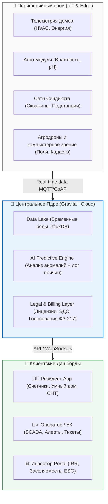

# 📊 Раздел 7. Управление на основе данных: ключевые показатели, ситуационный центр и метрики продуктивности

## 🧭 Навигация

- Вход: [README.md](README.md) · [Манифест-Питчбук](ТЭО_Родовое_Поместье_Введение_1_Манифест_Питчбук.md)
- Проверка: [Приложение 4: Источники и Бенчмарки](ТЭО_Родовое_Поместье_Приложение_4_Источники_и_Бенчмарки.md)
- Переход: [← Раздел 6. Финансовый инжиниринг](ТЭО_Родовое_Поместье_Раздел_6_Дом_в_ипотеку.md) · [Раздел 8. Правовые схемы реализации →](ТЭО_Родовое_Поместье_Раздел_8_Правовые_схемы_реализации.md)

---

> **Инвестиционный тезис:** Классический девелопмент завершает измерение эффективности на продаже квадратных метров. Родовое Поместье 3.0 рассматривает ввод домов в эксплуатацию как первый день запуска распределённого вычислительного и сервисного контура. Эффективность кластера оценивается по доступности узлов, пожизненной ценности резидента, энергоэффективности сети и объёму созданной интеллектуальной собственности. Управление идёт через единый ситуационный центр Gravita+.

---

## 🧠 7.1. Концепция: Кластер как высоконагруженная система интернета вещей

Мы уходим от декларативных отчетов к **математически точному управлению в реальном времени**. Экосистема Родовое Поместье 3.0 генерирует терабайты данных ежедневно. Эти данные монетизируются, оптимизируют Операционные расходы и превентивно устраняют аварии.

Ситуационный центр агрегирует данные из трёх слоёв:
1. **Машинный слой:** телеметрия интеллектуальной энергосети, датчики микроклимата, статус серверных стоек, потребление воды и тепла, беспилотный мониторинг агро-модулей.
2. **Операционный слой:** ERP синдиката, биллинг подписок, загрузка общих пространств и графики лизинговых платежей.
3. **Пользовательский слой:** индекс социальной вовлечённости, обращения в техподдержку и метрики продуктивности НИОКР-команд.

---

## 📋 7.2. Матрица целевых показателей

В отличие от стандартного ИЖС, KPI Родовое Поместье 3.0 разделены на инфраструктурные (ответственность Синдиката) и резидентские (социально-экономические метрики узлов).

### Блок А: Инженерно-инфраструктурные показатели
Измеряет устойчивость инфраструктуры и качество сервиса синдиката.

| Метрика | Целевой бенчмарк | Инструмент контроля | Влияние на экономику |
| :--- | :--- | :--- | :--- |
| **Доступность базового ядра** | **> 99.9%** для серверных узлов | Системы мониторинга Gravita+ | Гарантия непрерывности бизнес-процессов резидентов |
| **Доля автономной генерации** | **> 60%** генерации из локальных ВИЭ | Умные счётчики | Снижение операционных расходов на внешние энергоресурсы |
| **PUE (Power Usage Effectiveness)** | **< 1.2** для серверных модулей хаба | Телеметрия охлаждения | Прямая экономия на инфраструктуре ЦОД |
| **SLA обработки инцидентов** | **< 15 мин** на критические алерты IoT | AI-помощник / Диспетчерская | Снижение рисков деградации активов |
| **Zero Trace Index** | **> 85%** реверсивности модулей | Паспорта материалов (BOM) | Ликвидность б/у модулей на вторичном рынке |

### Блок Б: Финансово-экономические показатели синдиката
Измеряет эффективность капитала институциональных инвесторов.

| Метрика | Целевой бенчмарк | Инструмент контроля | Влияние на экономику |
| :--- | :--- | :--- | :--- |
| **Инфраструктурная внутренняя норма доходности (IRR)** | **18 - 25%** | ERP синдиката и аудит | Привлекательность для инвесторов |
| **Период окупаемости (Инфраструктура)** | **5 - 7 лет** | Фин. отчетность | Скорость возврата оборотного капитала |
| **Доля повторяющейся сервисной выручки** | **> 30%** от общей выручки синдиката | Биллинг подписок | Устойчивость к волатильности девелоперского цикла |
| **Стоимость привлечения клиента** | на 40% ниже рынка элитного ИЖС | CRM | Оптимизация маркетинговых бюджетов через рекомендации |

### Блок В: Венчурные и социально-демографические показатели
Измеряет качество человеческого капитала — главного актива кластера.

| Метрика | Целевой бенчмарк | Инструмент контроля | Влияние на экономику |
| :--- | :--- | :--- | :--- |
| **Пожизненная ценность резидента (LTV)** | **20+ лет** | Платформа и ротации | Фундамент рентабельности экосистемы |
| **Десятилетний прирост демографии (Коэф. Фертильности)** | **> 2.5 детей на семью** | ИС Gravita+ аналитика | Выполнение стратегических KPI государства (суверенитет) |
| **Патентная активность и лицензионные роялти** | **Рост пула лицензий Инициатора и синдиката** | Лицензионные договоры и реестр ИС | Рост пассивной выручки без увеличения капитальных затрат |
| **Индекс репутации УК и сервисов (Gravita Score)** | **> 4.8/5.0** (Уровень доверия к инфраструктуре и сделкам) | Двусторонняя оценка качества сервиса (без карательного социального скоринга людей) | Защита качества среды и прямая привязка бонуса УК (DRPR) к удовлетворённости жителей |

### Блок Г: Этико-экономические показатели (Конституционный контур Кодекса Процветания)
Оценивает соблюдение 12 строк Кодекса Процветания в операционной деятельности узла.

| Метрика | Целевой бенчмарк | Строка Кодекса | Инструмент контроля |
| :--- | :--- | :--- | :--- |
| **Индекс потерь (энергия, вода, органика, неиспользуемые данные)** | **< 5% невозвратных потерь** | Строка 7 | Телеметрия счётчиков + аудит хранилищ Edge-ЦОД |
| **Норматив «Десятой части» в Фонд развития сообщества** | **2,5% пол → 10% целевой** | Строка 6 | Публичный отчёт УК и Совета кооператива |
| **Срок расчётов с местными мастерами и поставщиками** | **NET-0 / NET-7 (0 просрочек)** | Строка 3 | Автоматический платёжный контур биллинга |
| **Резерв ликвидности и мощности сети** | **≥ 20% запаса** | Строка 8 | Стресс-тест казначейства и Smart Grid |
| **Прозрачность и оспоримость ИИ-решений** | **100% логов открыты для апелляции человеком** | Строка 12 | Журнал решений диспетчерской Gravita+ |

---

## 🎯 7.3. Целевые метрики Трансформации (по стандартам мировых экосистем)

**Технологические показатели:**
* **Уровень автоматизации процессов (SOP/Оpen-Loop vs Closed-Loop):** Целевой показатель > 85% процессов управляется IoT/AI без участия оперативного персонала.
* **Эффективность использования ресурсов (Energy/Water Efficiency):** Снижение энергопотребления на 40% за счет AI-балансировки Smart Grid / микрогрид.
* **Скорость внедрения инноваций (Time-to-Market):** Адаптация новых технологий в рамках НИОКР сектора за < 3 месяца (от теста до масштабирования на все дома).

**Экономические показатели (Многовекторность):**
* **Стабильность доходов:** Отклонение денежного потока (Cash Flow Volatility) < 5% в год за счет диверсификации инфраструктурная подписка.
* **Структура OpEx:** Снижение операционных расходов на 30% за счет предиктивной аналитики износа инфраструктуры.
* **Рентабельность и окупаемость:** Поддержание IRR > 25%, выход на самоокупаемость экосистемы (BEP) на 3-й год.

**Социальные и Экологические показатели:**
* **Уровень развития человеческого капитала:** Вовлеченность резидентов в образовательные и проектные платформы кластера > 70%.
* **Удовлетворенность резидентов:** Индекс NPS (Net Promoter Score) инфраструктуры > 85.
* **Качество жизни и Устойчивость:** Достижение 100% цикличной утилизации отходов (Zero Waste KPI) и отрицательного углеродного следа.

---

## 🖥️ 7.4. Архитектура ситуационного центра

Система управления работает по принципу «Цифрового двойника» (Digital Twin) всего поселения.

### 7.4.1. Уровни доступа к данным

1. **Инвесторский вид:** агрегированные метрики заселяемости, финансовых потоков и экологической эффективности.
2. **Операторский вид (УК Синдиката):** тепловые карты нагрузки на электросеть, алерты о предаварийных ситуациях (например, падение давления в насосной станции), статус обработки заявок (Helpdesk).
3. **Вид Резидента (Mobile App):** персональный биллинг, управление умным домом, бронирование зон в Общем Доме, маркетплейс локальных продуктов, интерфейс добровольных голосований СНТ и журнал доступа к собственным данным (строка 12 Кодекса, принцип переносимости по образцу X-Road).

---

## ⚡ 7.5. AI-Предиктивная аналитика против «Тушения пожаров»

DeepTech-хаб не ждёт, пока труба прорвётся. AI-модели Ситуационного центра работают в режиме **предиктивного обслуживания (Predictive Maintenance)**:

* **Пример 1 (Энергетика):** AI анализирует прогноз погоды (снижение облачности) и график нагрузки резидентов. Система превентивно охлаждает серверные стойки ночью по ночному тарифу, понимая, что днем потребуется пиковая мощность для кондиционирования хаба, которая будет покрыта солнечными панелями.
* **Пример 2 (Инженерия):** Датчики вибрации на циркуляционном насосе центральной скважины фиксируют микроизменения. Система автоматически создает тикет для инженера на «Профилактический осмотр оси» за 2 недели до потенциального выхода из строя. Zero downtime.

---

## 🌎 7.6. ESG-Комплаенс и «Голубые зоны» (Blue Zones)

Помимо жестких технических метрик, проект реализует стандарты устойчивого развития (ESG), что критически важно для привлечения институциональных траншей и субсидий. Оценка качества среды базируется на принципах международных «Голубых зон» (регионы с максимальной продолжительностью продуктивной жизни).

| Метрика ESG / Blue Zone | Инструмент контроля / Верификация | Ценность для проекта |
| :--- | :--- | :--- |
| **Снижение CO2 эмиссии** | Мониторинг замены ДВС-транспорта на EV внутри кластера, использование ВИЭ | Сертификация «Зеленого поселения» (премии по кредитным ставкам) |
| **Regenerative Agriculture** | Лабораторный анализ % гумуса в почве (индекс восстановления) | Повышение биологической капитализации земли |
| **Индекс здоровья резидентов** | Интеграция с Wearables (опционально, по согласию), статистика заболеваемости | Доказательная база высокой продуктивности НИОКР-команд |
| **Walkability Score** | Анализ пешеходных маршрутов (отсутствие транзитного авто-трафика в жилых зонах) | Повышение привлекательности для семей с детьми (Safety 1st) |

## ✅ 7.7. Вывод

Матрица KPI Родового Поместья 3.0 переводит управление загородным хабом из плоскости «коммунального хозяйства» в плоскость управления **распределённым дата-центром и венчурным инкубатором**. Высокая гранулярность данных обеспечивает инвесторам прозрачность, а резидентам — сервис уровня Tier III без вмешательства в частную жизнь.

## 7.8. Оцифрованные Метрики (Модельные KPI 2026–2027)

Для ликвидации разрыва между документацией и практической реализацией внедрён дашборд целевых показателей первого инфраструктурного узла (Фаза А–B):

**Краткосрочные KPI (до конца 2026 г.):**
* *Правовые:* Утверждение Земельного меморандума и регистрация ЗПИФ.
* *Технологические:* Запуск базового инфраструктурного узла (Uptime 99.9%), оцифровка Общего Дома и сервисного цеха на полигоне ПРП ONN ([Приложение 1](ТЭО_Родовое_Поместье_Приложение_1_Практический_кейс_ONN.md)).
* *Рыночные:* Подписание 3 LOI (соглашений о намерениях) от B2B-партнеров на аренду инфраструктуры и конвертация ранних заявок в твёрдые бронирования.

**Среднесрочные KPI (2027 г. — Масштабирование):**
* *Финансовые:* Выход полигона на точку безубыточности (по OPEX) к 14-му месяцу; достижение ежемесячного денежного потока с узла свыше 450 тыс. руб.
* *Апсайд:* Инкубация минимум 1 проекта резидента, получившего внешний грант (ФСИ / РНФ).

---

## 7.9. Пакет подтверждения спроса и воронка трекшна (единый стандарт по ТЭО)

> *Единая сверка цифр воронки для разделов 7, 13, 14 и 15 (VDR).*

Для подтверждения институциональной готовности проекта к открытию виртуальной комнаты данных сформирована трёхступенчатая воронка спроса:

1. **Трекшн по резидентам (воронка B2C):**
   * **340** квалифицированных лидов в общей обезличенной базе предзаказов (`VDR_5.1`).
   * **150+** верифицированных анкет специалистов и семей в листе ожидания первой очереди.
   * **40+** глубинных CustDev-интервью с целевой аудиторией.
   * **15** подписанных писем о намерениях (LOI) и **5** возвратных депозитов на раннее бронирование лотов в пилотном узле.
2. **Трекшн по инфраструктуре и вычислениям (B2B):**
   * Предварительный меморандум (MOU) с региональным интегратором на аренду **30% мощности** периферийного ЦОДа под задачи машинного обучения.
   * Соглашение о намерениях с AgroTech-дистрибьютором о выкупе 100% продукции фитотрона узла 1.
   * Действующий полигон **ПРП ONN** (88 поместий, Общий Дом 60–70 м²: стабильный интернет с 19.08.2026, коворкинг с 01.09.2026, строящийся сервисный цех 150 м², пруд 0,8–1 га и единственная производственная площадь 8 га).
3. **GR Traction:**
   * Письмо поддержки профильного регионального ведомства (содействие в получении статуса резидента технопарка / КРТ).

*Все указанные документы деперсонализированы в публичной версии ТЭО и доступны в полном объёме в комнате данных для инвесторов, проходящих стадию аудита.*
