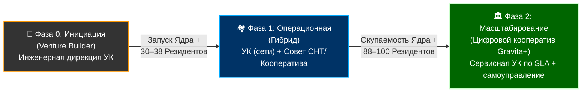
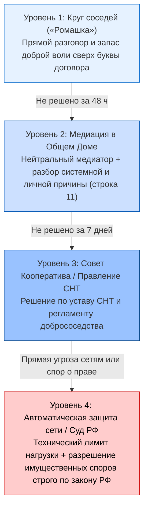

# 🏛️ Раздел 9. Организационная структура и эволюция управления кластером

## 🧭 Навигация

- Вход: [README.md](README.md) · [Манифест-Питчбук](ТЭО_Родовое_Поместье_Введение_1_Манифест_Питчбук.md) · [Кодекс Процветания](Экономические_Принципы_Мировых_Религий_Кодекс_Процветания.md)
- Проверка: [Приложение 4: Источники и Бенчмарки](ТЭО_Родовое_Поместье_Приложение_4_Источники_и_Бенчмарки.md)
- Переход: [← Раздел 8. Правовые схемы](ТЭО_Родовое_Поместье_Раздел_8_Правовые_схемы_реализации.md) · [Раздел 10. Риски и пути их минимизации →](ТЭО_Родовое_Поместье_Раздел_10_Риски_и_пути_их_минимизации.md)

---

> **Инвестиционный тезис:** Главная причина провала 90% классических «экопоселений» — попытка играть в стихийные собрания на этапе возведения сложных инженерных систем. Родовое Поместье 3.0 разделяет контуры по **строке 9 Кодекса (актив длиннее одной команды)**: на этапе капитального строительства инженерным ядром управляет профессиональная Управляющая компания (Venture Builder), а по мере ввода узлов в эксплуатацию управление общественной жизнью, кружками и фондом развития передаётся Совету кооператива и резидентам через юридически значимую учётную систему волеизъявления Gravita+ (ФЗ-217 ст. 17 п. 21).

---

## 🌱 9.1. Архитектура управления: три фазы зрелости

Переход между фазами привязан к измеримым KPI (Node Uptime, точка безубыточности, число подключённых домохозяйств), а не к формальному календарю.

### Фаза 0: Инициация и стройка (Venture Builder)
*Тип управления: профессиональная инженерная дирекция.*
- **Ключевой орган:** Управляющая компания «Нейро-Эстейт УК» / Мастер-девелопер.
- **Фокус:** Привлечение капитала, GR-согласования (КРТ, ВРИ земли), прокладка оптоволокна, запуск энергоцентра (Smart Grid / микрогрид), оцифровка пилотного узла ПРП ONN и аккредитация подрядчиков префаб-модулей.
- **Роль будущего жителя:** Заказчик своего «Оплота» и участник онбординга. Резидент не несёт строительных рисков ядра и не вмешивается в выбор сечения кабеля или настройку серверных стоек.

### Фаза 1: Эксплуатация и сообщество (Гибридная модель)
*Тип управления: разделение инженерной и общественной ветвей.*
- **Управляющая компания (УК ЗПИФ):** Сохраняет 100% операционной ответственности за критическую инфраструктуру (ЦОД, энергосеть, водоподготовка, дороги) и отвечает перед СНТ рублём по договору SLA.
- **Совет Кооператива / Правление СНТ:** Управляет общественной жизнью, расписанием Общего Дома ([Приложение 5](ТЭО_Родовое_Поместье_Приложение_5_Расписание_Общего_Дома.md)), дизайн-кодом и распределением **Фонда развития сообщества (2,5–10% выручки по строке 6 Кодекса)**.
- **Инженерное вето безопасности:** УК вправе заблокировать только то техническое решение, которое несёт прямую угрозу безопасности сетей, экологии участка или нарушает ПУЭ/ГОСТ.

### Фаза 2: Зрелый узел и масштабирование сети
*Тип управления: договорное самоуправление на платформе Gravita+.*
- **Ключевой орган:** Общее собрание и Совет кооператива через электронное волеизъявление в ИС Gravita+ (в рамках ФЗ-217 и ЖК РФ ст. 47.1 — см. [Раздел 8.6](ТЭО_Родовое_Поместье_Раздел_8_Правовые_схемы_реализации.md)).
- **Фокус:** УК работает как сервисный оператор по открытому SLA; стратегические бюджеты развития территории, запуск новых мастерских и образовательных программ утверждаются жителями.

---

## 👥 9.2. Организационная структура УК и Совет старейшин / наставников

Штатное расписание спроектировано как у инженерно-продуктовой компании, дополненной институтом наставничества (строки 3 и 9: опыт старших — капитал, и он оплачивается).

| Роль | Зона ответственности и KPI | Компетенции |
| :--- | :--- | :--- |
| **Главный Инициатор / Chief Visionary Architect** | Архитектура смыслов, технологических альянсов и базового IP платформы Gravita+. Защищён лицензионным договором (DRPR с капом бонуса +1% при NPS > 80 и ESG > 4.5). Дистанцирован от бытовых и кассовых споров. | Системная архитектура, Data Science / AI, концептуальный девелопмент 10+ лет. |
| **CEO (Генеральный директор УК)** | Операционное управление, привлечение инвестиций, GR (КРТ, ОЭЗ), контроль подрядчиков СМР и выполнение SLA перед резидентами. | PropTech / инфраструктурный менеджмент, управление бюджетами, M&A. |
| **CTO (Технический директор)** | Бесперебойная работа инженерного и вычислительного ядра (сети, Edge-ЦОД, Smart Grid, локальный контур умного дома). | High-load системы, микрогриды, промышленный и бытовой IoT (Zigbee/MQTT). |
| **CFO (Финансовый директор)** | Управление контуром ЗПИФ, разделение трёх финансовых сосудов (строка 4), расчёты NET-0/NET-7 с мастерами (строка 3), эскроу. | Корпоративные финансы, право ЗПИФ (ФЗ-156), казначейский контроль. |
| **CPO (Директор по продукту Gravita+)** | Разработка биллинга, личного кабинета СНТ,Agro-API и клиентского пути резидента с соблюдением принципа паузы («Ма»). | Продуктовый менеджмент, UX/UI, интеграция локальных и облачных LLM. |
| **Head of Community & Mediation** | Онбординг новых семей, фасилитация кругов «ромашек», работа с запросами жителей и координация образовательных программ Общего Дома. | Фасилитация, медиация, развитие локальных сообществ. |
| **Совет наставников и мастеров (оплачиваемая роль старших)** | Передача ремесленного, агрономического, инженерного и педагогического опыта; ведение кружков и надзор за качеством работ. | Опытные профессионалы старшего поколения из числа резидентов (пенсия как оплачиваемое наставничество). |

---

## ⚖️ 9.3. Протокол разрешения споров и этическая граница (корень, строки 2 и 12)

В живом сообществе споры неизбежны. Чтобы они не перерастали в затяжные конфликты, применяется четырёхуровневый протокол без унижения достоинства и без китайского «социального рейтинга»:

### Принципы медиации и отказы от токсичных практик:
1. **Запрет на манипулятивный социальный скоринг (строка 12 Кодекса):** В РП 3.0 нет слежки дронами за бытом жителей и нет автоматических «социальных штрафов». Индекс *Gravita Score* оценивает **качество работы самой УК, сервисов и добросовестность исполнения B2B-подрядов**, а не личную жизнь семьи.
2. **Право остановить дефект (строка 2):** любой резидент или мастер вправе подать сигнал об экологическом вреде, нарушении техники безопасности или браке подрядчика. Сигнал приостанавливает приёмку до проверки на месте.
3. **Аппаратная защита ядра:** Если на участке возникает короткое замыкание или аварийная перегрузка фазы, срабатывает селективная автоматика щита (см. [Приложение 7](ТЭО_Родовое_Поместье_Приложение_7_Электрощит_DIY_Монтаж.md)), защищая соседей, при этом базовое жизнеобеспечение и проезд к дому остаются неприкосновенными.

---

## 🗳️ 9.4. Инструменты цифрового кооператива (ИС Gravita+ в правовом поле РФ)

Все процедуры участия резидентов являются **строго добровольными** (корень Кодекса) и опираются на российское право (ФЗ-217 ст. 17 п. 21):

1. **Инициативное бюджетирование Фонда развития (2,5–10%):** Резиденты выдвигают проекты развития посёлка (оборудование для мастерской, посадка рощи, инвентарь для детских секций Общего Дома) и распределяют целевой бюджет открытым электронным голосованием.
2. **Экспертные комитеты по компетенциям:** В профильных рабочих группах (энергетика, агро-хаб, ИТ, образование) решения готовят резиденты с подтверждённой квалификацией, после чего выносят их на утверждение правления СНТ.
3. **Общая работа руководства:** члены правления и топ-менеджмент УК регулярно работают на земле и в Общем Доме наравне с резидентами, чтобы управление не отрывалось от места.

---

## 🛡️ 9.5. Преемственность, Advisory Board и защита от ключевого лица (строка 9)

По строке 9 проект защищён от ухода любого отдельного руководителя или инженера:

1. **Документирование по умолчанию (Documentation by Design):** Вся инженерная и цифровая инфраструктура имеет открытые паспорта, однолинейные схемы щитов ([Приложение 7](ТЭО_Родовое_Поместье_Приложение_7_Электрощит_DIY_Монтаж.md)), репозитории конфигураций и инструкции по ручному управлению без облака ([Приложение 6](ТЭО_Родовое_Поместье_Приложение_6_Умный_Дом_Алиса_Общий_Дом.md)).
2. **Advisory Board (Наблюдательный и попечительский совет):** Включает профильных экспертов по упаковке ЗПИФ недвижимости, архитектуре распределённых ИТ-систем, правовому сопровождению КРТ/ИНТЦ и научной валидации агробиотехнологий (персональные анкеты раскрываются в `VDR_6.3` под NDA). При отборе в Core Team и Advisory Board стрессоустойчивость и привычка искать причину, а не виновного (строка 11), оцениваются наравне с профессиональной квалификацией.
3. **Опционный пул и вестинг (ESOP):** Для удержания ключевой инженерной и управленческой команды формируется опционный пул **10–15%** в УК со стандартным четырёхлетним вестингом и годовым клиффом (1 год Cliff), привязанный к вводу реальных узлов и удержанию удовлетворённости резидентов.
